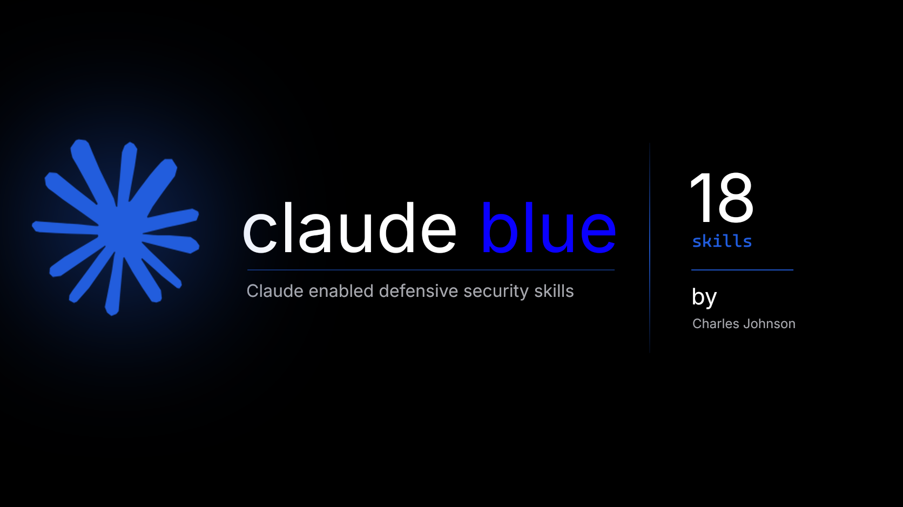

[](assets/banner.png)

<div align="center">

# claude-blue

**Defensive security skills for Claude — drop-in `SKILL.md` files that turn Claude into a context-aware blue team analyst that works beside you, not instead of you.**

[](LICENSE) [](#skill-index) [](#categories) [](tools/validate.py) [](https://github.com/ifindvulnerabilities/claude-blue) [](https://github.com/ifindvulnerabilities/claude-blue/network/members)

A defensive companion inspired by [claude-red](https://github.com/SnailSploit/claude-red).

[Overview](#overview) &bull; [Quickstart](#quickstart) &bull; [Categories](#categories)  &bull; [Skill Index](#skill-index) &bull; [Principles](#principles) &bull; [Roadmap](#roadmap) &bull; [Contributing](#contributing)

</div>

---

## Overview

`claude-blue` is a curated library of defensive security skills for the [Claude Skills system](https://docs.claude.com). Each skill is a structured `SKILL.md` file that primes Claude with expert-level methodology for a specific blue team task — from decoding a suspicious command line to reviewing a Sigma rule, from reading CloudTrail to checking an incident report against the evidence.

Drop a skill into your Claude environment and it behaves like a seasoned colleague: it knows the telemetry, the event IDs, the false-positive traps and the questions a senior analyst would ask. Skills load on demand based on conversational triggers — you don't pay context for skills you aren't using.

What it never does is take the decision away from you. Every skill lays out the evidence, states its confidence, and ends with **YOUR CALL**.

**Use it for:** SOC triage, alert and log interpretation, phishing and BEC review, detection engineering, incident response, threat-intel reading, configuration and pentest-report review, and training the next generation of analysts.

---

## Quickstart

### Claude Code (recommended)

```bash
# Clone the library
git clone https://github.com/ifindvulnerabilities/claude-blue
cd claude-blue
# Install every skill into your personal skills directory (~/.claude/skills)
./install.sh
# Or install only one category
./install.sh --category soc
```

Claude will auto-load matching skills based on conversational triggers (e.g. pasting an encoded PowerShell line and asking "what does this do" loads `defensive-command-explainer`).

### Project install (share with your team)

```bash
# Install into a repo's (commit it)/directory's .claude/skills/ and everyone on the team gets the skills
./install.sh --target /path/to/your-repo/.claude/skills
```

### Claude.ai

Zip a single skill folder (the folder containing `SKILL.md`, plus its `references/` if it has one) and upload it under **Customize → Skills → + → Create skill → Upload a skill**. One zip per skill. Code execution and file creation must be enabled for your plan.

### Install Script

```bash
./install.sh                           # all skills → ~/.claude/skills
./install.sh --target ~/.claude/skills # explicit target
./install.sh --category ir             # one category
```

---

## Categories

| Category | Skills | Focus |
|---|---|---|
| [SOC](#soc) | 6 | Triage, commands, logs, phishing, web attacks, checking AI-tool verdicts |
| [Detection Engineering](#detection-engineering) | 1 | Sigma, KQL, SPL, YARA and regex peer review |
| [Incident Response](#incident-response) | 4 | Report review, timelines, playbooks, blameless post-incident reviews |
| [Identity](#identity) | 1 | Entra ID and Okta sign-in and audit logs |
| [Cloud](#cloud) | 1 | CloudTrail, Azure Activity and GCP audit logs |
| [Threat Intelligence](#threat-intelligence) | 1 | Report digestion, candidate ATT&CK mapping, relevance |
| [Hardening](#hardening) | 2 | Config review, pentest-report remediation planning |
| [People](#people) | 2 | Security writing, Socratic analyst coaching |

---

## Skill Index

### SOC

`Skills/soc/`

| Skill | Description |
|---|---|
| [`defensive-command-explainer`](Skills/soc/defensive-command-explainer/SKILL.md) | Command & script explainer — safe decoding, LOLBins, attention patterns |
| [`defensive-log-interpreter`](Skills/soc/defensive-log-interpreter/SKILL.md) | Log interpreter — Windows, Sysmon, Linux, cloud; what a log proves and doesn't |
| [`defensive-alert-triage-companion`](Skills/soc/defensive-alert-triage-companion/SKILL.md) | Alert triage — competing hypotheses, evidence for/against, decisive checks |
| [`defensive-phishing-review`](Skills/soc/defensive-phishing-review/SKILL.md) | Phishing & BEC — headers, SPF/DKIM/DMARC, links-as-text, inbox rules |
| [`defensive-web-attack-log-review`](Skills/soc/defensive-web-attack-log-review/SKILL.md) | Web attack logs — attempted vs successful SQLi, SSRF, traversal, uploads |
| [`defensive-ai-output-check`](Skills/soc/defensive-ai-output-check/SKILL.md) | AI output check — challenge AI SOC verdicts, claims vs evidence, injection |

### Detection Engineering

`Skills/detection/`

| Skill | Description |
|---|---|
| [`defensive-detection-rule-review`](Skills/detection/defensive-detection-rule-review/SKILL.md) | Rule review — logic, evasion gaps, false positives, performance, test cases |

### Incident Response

`Skills/ir/`

| Skill | Description |
|---|---|
| [`defensive-incident-summary-review`](Skills/ir/defensive-incident-summary-review/SKILL.md) | Incident summary review — omissions, overstatement, audience fit |
| [`defensive-timeline-review`](Skills/ir/defensive-timeline-review/SKILL.md) | Timeline review — timezones, inferred links, lifecycle gaps |
| [`defensive-playbook-review`](Skills/ir/defensive-playbook-review/SKILL.md) | Playbook review — owners, approval gates, evidence preservation, tabletops |
| [`defensive-post-incident-review`](Skills/ir/defensive-post-incident-review/SKILL.md) | Post-incident review — blameless facilitation, contributing factors, actions |

### Identity

`Skills/identity/`

| Skill | Description |
|---|---|
| [`defensive-signin-log-interpreter`](Skills/identity/defensive-signin-log-interpreter/SKILL.md) | Sign-in logs — Entra ID & Okta risk, conditional access, MFA, OAuth consent |

### Cloud

`Skills/cloud/`

| Skill | Description |
|---|---|
| [`defensive-cloud-audit-interpreter`](Skills/cloud/defensive-cloud-audit-interpreter/SKILL.md) | Cloud audit — CloudTrail, Azure Activity, GCP audit; IAM, keys, logging changes |

### Threat Intelligence

`Skills/intel/`

| Skill | Description |
|---|---|
| [`defensive-threat-intel-review`](Skills/intel/defensive-threat-intel-review/SKILL.md) | Threat intel — behaviours, candidate ATT&CK mappings to verify, relevance |

### Hardening

`Skills/hardening/`

| Skill | Description |
|---|---|
| [`defensive-config-review`](Skills/hardening/defensive-config-review/SKILL.md) | Config review — IAM, firewall, GPO, SSH, K8s RBAC; what it actually allows |
| [`defensive-pentest-report-review`](Skills/hardening/defensive-pentest-report-review/SKILL.md) | Pentest report — understand findings, contextual severity, remediation plan |

### People

`Skills/people/`

| Skill | Description |
|---|---|
| [`defensive-security-writing-review`](Skills/people/defensive-security-writing-review/SKILL.md) | Security writing — clearer notes, handoffs and stakeholder emails, facts locked |
| [`defensive-analyst-coach`](Skills/people/defensive-analyst-coach/SKILL.md) | Analyst coach — Socratic practice that builds investigative judgement |

> **Shared references:** lookup tables used by several skills (Windows security events, command-line attention patterns) live in [`shared/references/`](shared/references/). Skills carry copies; `python tools/validate.py --sync-shared` keeps them in step.

---

## Principles

claude-red turns Claude into an operator. claude-blue turns Claude into a colleague, and it holds to seven principles; enforced in CI on every skill:

1. **The human decides.** No verdicts, no closed cases, no actions. Every output ends with **YOUR CALL**.
2. **Evidence before opinion.** Claims tied to quoted input; confidence stated plainly; "I can't tell" is a valid answer.
3. **Review, not replace.** You write the report, the rule, the timeline. Claude checks it.
4. **Grow the defender.** Say *"coach me"* to any skill and it asks instead of answers.
5. **Protect people and data.** Redaction reminders, no profiling, never handles credentials.
6. **Fail safe, never act.** Containment ideas are options with impact and rollback, for a human to approve.
7. **Respect the work and the worker.** Blameless reviews, humane operations, no productivity surveillance.

Full reasoning in [PRINCIPLES.md](PRINCIPLES.md), inspired by the Vatican's *Antiqua et Nova* and Pope Leo XIV's *Magnifica Humanitas*. The evidence base — what analysts actually use AI for — is in [RESEARCH.md](RESEARCH.md).

---

## Roadmap

The library is being built in phases. Each commit updates this table to reflect what has shipped. Track progress in [CHANGELOG.md](CHANGELOG.md).

| Phase | Category | New Skills | Status |
|---|---|---|---|
| 1 | Initial Commit (Numerous Skills added: SOC, hardening, detection, and more! ) | +18 | **Done** |


Current state: 18 skills across 8 categories.

---

## Contributing

Contributions welcome. See [CONTRIBUTING.md](CONTRIBUTING.md) for the [skill template](templates/SKILL_TEMPLATE.md), frontmatter standard, and review process. Focused, single-task skills are preferred over monolithic overviews.

Every skill must pass the validator, which CI runs on every pull request:

```bash
pip install pyyaml
python tools/validate.py
```

## License

[MIT](LICENSE) — use freely, attribution appreciated.

## Acknowledgements

- **Author:** Charles Johnson — [CyberWatch](https://CyberWatch.cc)

- **Inspiration:** [claude-red](https://github.com/SnailSploit/claude-red) by Kai Aizen (SnailSploit) — the offensive library this one answers.

- **Assistance**: Claude for expediting the research and writing required for this repo.

- **Research:** Singh et al., *LLMs in the SOC* (2025), and Kramer et al., *Integrating LLMs into Security Incident Response* (SOUPS 2025), whose findings shaped every skill.

- **Community:** PRs and feedback from defenders that keep the library updated and worth using.

---

> [!NOTE]
> Claude-Blue supports trained people doing defensive work. It does not replace professional judgement, legal advice or your organisation's policies; follow your organisation's rules on what data may be shared with AI tools. Not affiliated with Anthropic, SnailSploit or the Holy See.

---

<div align="center">

*Give Claude the right skill, and it stops being a chatbot. It becomes a tool, useful to humans instead of their replacement.*

[CyberWatch](https://CyberWatch.cc/) &bull; [GitHub](https://github.com/ifindvulnerabilities) &bull; [Principles](PRINCIPLES.md) &bull; [Research](RESEARCH.md) &bull; [Changelog](CHANGELOG.md)

</div>
